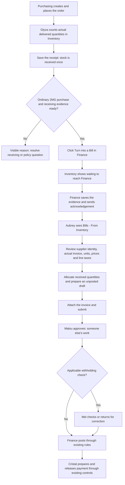

# Buying from suppliers - receipt to Finance

Installed locally for testing, November 11, 2026. Sending is disabled by default. Exact staff access and activation must be approved separately; no official or staff acceptance is claimed.

## What the action means

The button sends received evidence for Finance preparation. It does not receive stock again, certify an invoice, approve a bill or pay a supplier. The receiver stays on the receipt and sees the acknowledgement, waiting state and correction reason. Finance gets the linked source, not a retyped copy.

Ordered 100 boxes, received 60: send 60; 40 remain outstanding. If the invoice covers 50, allocate 50 and leave 10 available. A further invoice can use only the remaining quantities. Several compatible receipts can feed one supplier invoice. Repeated clicks and lost responses must recover the same saved work.

## Where to work

| Person / step | Screen | Their next action |
|---|---|---|
| Receiver | Inventory purchase receipt | Count/save, then use the explicit Finance button when eligible |
| Purchasing / receiver | PO's received deliveries | See each receipt's Finance state; open that receipt for details |
| Payables preparation | Finance Bills > From Inventory | Resolve supplier link or missing evidence, allocate invoice quantities and prepare draft |
| Bill preparer | Existing Finance bill | Check accounts and line taxes, attach invoice, submit |
| Approver / tax checker | Existing approval/tax queues | Approve/check someone else's work or return it with a reason |
| Payment release | Existing payment-voucher flow | Prepare/release only a bill that has cleared the required steps |

An incoming receipt is not yet a bill. A prepared draft is not yet an approved payable. A delivery reference is not automatically the supplier invoice number. Source supplier IDs are not Finance supplier IDs: an authorized reviewer confirms their link to the verified 2MG supplier.

## Usual tax code versus this order

A supplier's usual settings are starting suggestions. Finance still checks VAT (value-added tax) and withholding on the individual invoice lines, including an explicit reason where nothing is withheld. Local/Foreign classification does not settle the tax treatment of every product or import charge. Dispatch does not need to choose Finance's chart accounts or tax codes.

## Holds, retries and corrections

- **Not sent:** the receipt is still in Inventory. Counting alone never sends.
- **Waiting to reach Finance:** no business acknowledgement yet. Refresh/check the same saved handoff; do not receive stock again.
- **Needs Finance review:** the receipt arrived, but supplier or other evidence needs attention. This business hold is saved; it does not repeatedly fail message delivery.
- **Needs receiving correction:** the reason is visible on both sides. Finance does not silently change counted stock quantities.
- **Partly prepared:** some units are reserved for bills; the remainder stays visible.
- **Bill prepared:** open the linked draft if your Finance permissions allow it. Its approval/payment state remains separate.

Only an unsubmitted source-linked draft can be cancelled to release its quantities. The cancelled draft and its allocation history stay visible. Submitted/posted bills use the existing return/void controls; quantity reuse after a posted void requires reviewed policy. Cleanup cannot silently remove the source receipt, bill or linked accounting evidence.

Consignment uses its separate settlement flow. Quality-held receiving, uncertain foreign price/currency evidence, supplier advances and received-but-unposted accounting policy require the appropriate Finance/receiving decision. No guessed exchange rate, clearing account, supplier identity or approval is supplied to bypass a hold.

Code references: Inventory app/purchase_handoff.py, purchasing.py receipt handlers and receipt-finance.tsx; Platform app/events.py explicit routes; Finance app/purchase_intake.py, payables.py and the From Inventory screens. This guide changes no access or accounting setup.
